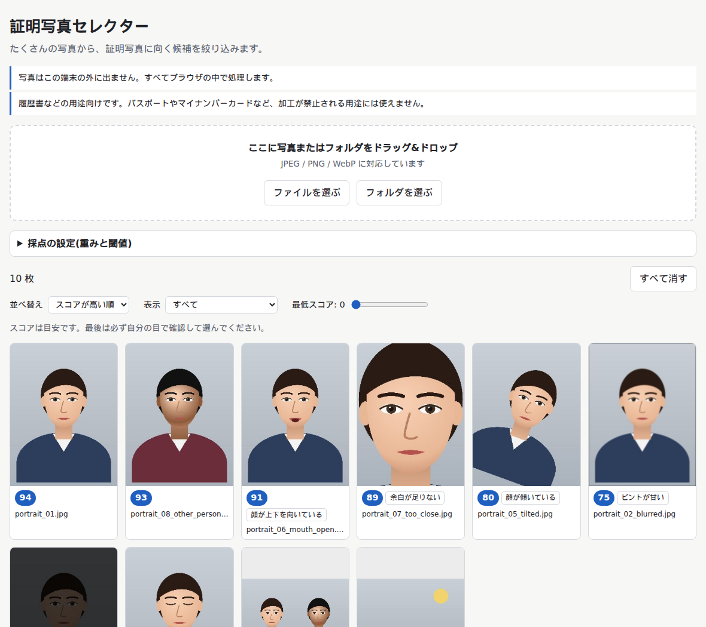
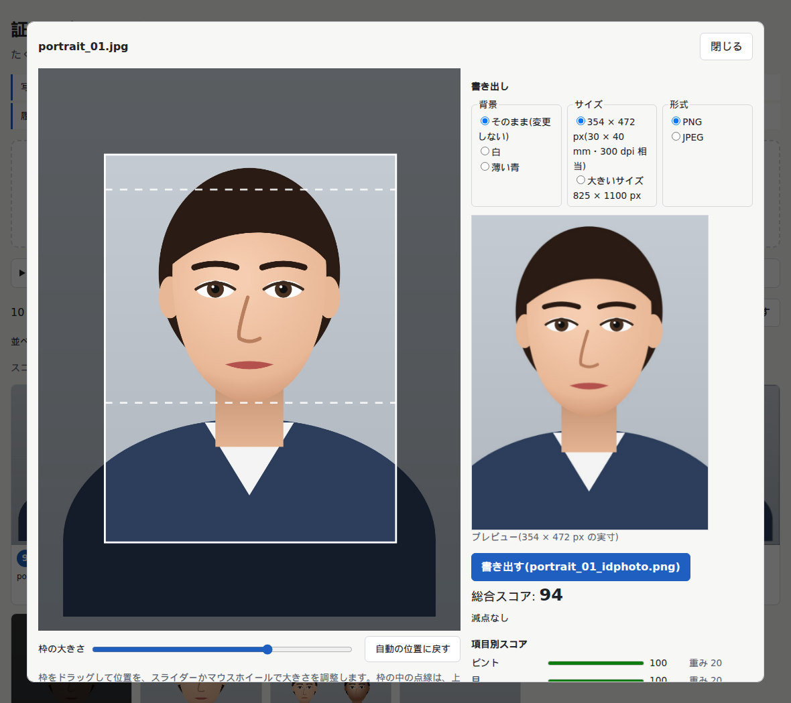

# 証明写真セレクター (id-photo-picker)

たくさんの写真から証明写真に向く候補を自動で絞り込み、3:4(縦 40 × 横 30 mm 相当)にトリミングして書き出す Web アプリです。**すべてブラウザの中で動き、写真はどこにも送信されません。**





※ スクリーンショットの人物は、図形で描いたイラストです(実在の人物ではありません)。

## できること

1. **読み込む** — ファイル選択、フォルダ選択、ドラッグ&ドロップ(フォルダごと可)。JPEG / PNG / WebP。
2. **自動で採点して並べる** — 写真ごとに 0–100 の総合スコアと、減点理由のタグ(「目が閉じている」「ピントが甘い」など)を表示します。
3. **自分の目で選ぶ** — 写真をクリックすると、項目別スコアと測定値を確認できます。スコアは目安で、最後に決めるのはあなたです。
4. **トリミングして書き出す** — 3:4 固定の枠をドラッグ・拡大縮小して調整し、354 × 472 px(30 × 40 mm・300 dpi 相当)または元の解像度を活かした大きいサイズで、PNG / JPEG に書き出します。ファイル名は `元の名前_idphoto.png` です。
5. **背景を無地にする(任意)** — 白または薄い青。実寸プレビューで縁を確認してから書き出せます。

### 採点項目

| 項目     | 見ているもの                                             |
| -------- | -------------------------------------------------------- |
| 顔の数   | ちょうど 1 人。0 人・2 人以上は「除外」として理由を表示  |
| ピント   | 顔の部分の鮮明さ                                         |
| 目       | 目が開いているか(閉じた写真は総合スコアを大きく下げます) |
| 口・表情 | 口が開いていないか、笑顔が強すぎないか                   |
| 正面度   | 顔の左右・上下の向きと傾き                               |
| 露出     | 顔の明るさ、白飛び・黒つぶれ、片側だけの影               |
| 構図     | 3:4 に切り出すための余白が足りるか                       |
| 解像度   | 切り出したときに 354 × 472 px を満たすか                 |

重みと閾値は、画面の「採点の設定」のスライダーで変えられます(このブラウザに数値だけ保存されます)。初期値とその根拠は [`src/scoring/config.ts`](src/scoring/config.ts) にあります。

## プライバシー

**写真はこの端末の外に出ません。**

- 解析・トリミング・背景処理・書き出しは、すべてあなたのブラウザの中で行います。サーバーへのアップロード、外部 API、アクセス解析、ログインはありません。
- 写真は保存しません(ページを閉じると消えます)。ブラウザに保存するのは、採点の重みと閾値の数値だけです。
- 顔解析のプログラムとモデルもこのサイト自身から読み込みます(外部 CDN なし)。
- **自分で確かめられます。** ブラウザの開発者ツール(F12)の Network タブを開いたまま使ってみてください。写真を読み込んでも、このサイト以外への通信は発生しません。

仕組みとしては、次の 3 つで守っています([ADR 0006](docs/adr/0006-no-telemetry.md))。

1. `Content-Security-Policy` で `connect-src 'self'`(このサイト以外へ接続させない)。
2. 解析を行う Worker の中では、このサイト以外への通信をコードで拒否。
3. 顔解析ライブラリ MediaPipe を、利用状況の計測値を送信しない版(0.10.35)に固定し、テストで監視。

## 用途と制限

- **履歴書等の用途向けです。** パスポート、マイナンバーカード、運転免許証など、規格が厳密な用途や加工が禁止されている用途には使えません。
- 顔そのものは加工しません。美肌、輪郭補正、目の拡大、生成 AI による加工・生成は行いません。
- 背景を無地にする機能は、壁などすっきりした背景でうまく働きます。物が写り込んでいると縁に残ることがあるので、必ずプレビューで確認し、気になる場合は「そのまま」で書き出してください。
- 切り出し枠の初期位置(頭頂の位置など)は推定です。髪型や帽子によってずれるので、枠を動かして合わせてください。
- **HEIC(iPhone の標準形式)は読み込めません。** 事前に JPEG へ変換してください(iPhone なら「設定 → カメラ → フォーマット → 互換性優先」で JPEG で撮影できます)。
- 書き出したファイルに解像度(dpi)の情報は入りません。印刷するときは 30 × 40 mm を指定してください。
- 一度に扱う枚数は数百枚までを想定しています。
- 動作確認は Chromium 系ブラウザで行っています。

## 開発

[Vite+](https://viteplus.dev/)(`vp`)を使います。

```sh
vp install
vp dev      # 開発サーバー
vp check    # フォーマット・lint・型チェック(--fix で自動修正)
vp test     # テスト
vp build    # dist/ に出力
vp preview  # ビルド結果を確認(CSP が有効になるのはこちら)
```

- 設計判断とその理由は [`docs/adr/`](docs/adr/) にあります。
- 作業の決まりは [`CLAUDE.md`](CLAUDE.md) にあります。
- `@mediapipe/tasks-vision` のバージョンは上げないでください(理由は ADR 0006)。
- 本人の写真をコミットしないでください。`samples/` は `.gitignore` 済みです。

## ライセンス

[MIT](LICENSE)

同梱している第三者のソフトウェアとモデル(Preact、MediaPipe とそのモデル)のライセンスは [`public/THIRD_PARTY_NOTICES.txt`](public/THIRD_PARTY_NOTICES.txt) と [`public/mediapipe/README.md`](public/mediapipe/README.md) に記載しています。
